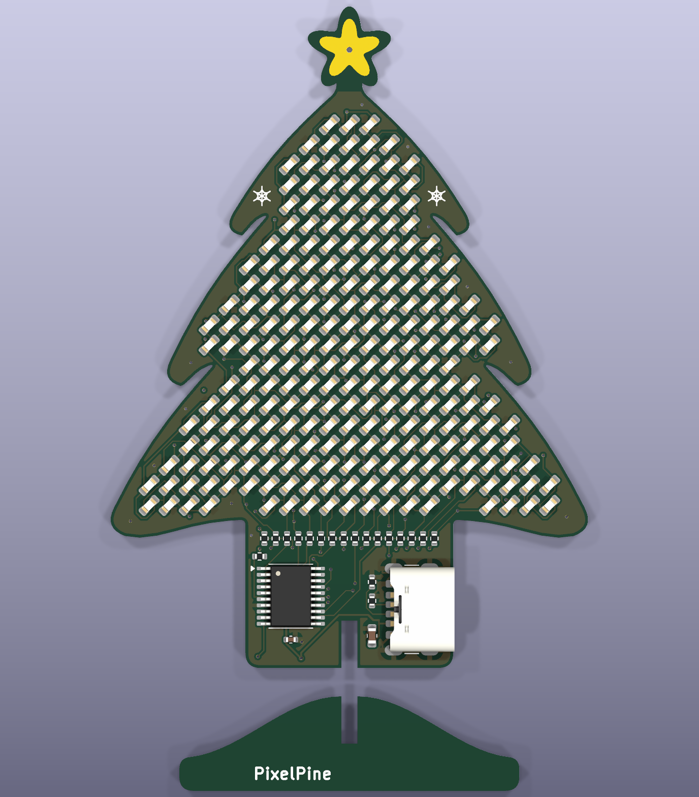
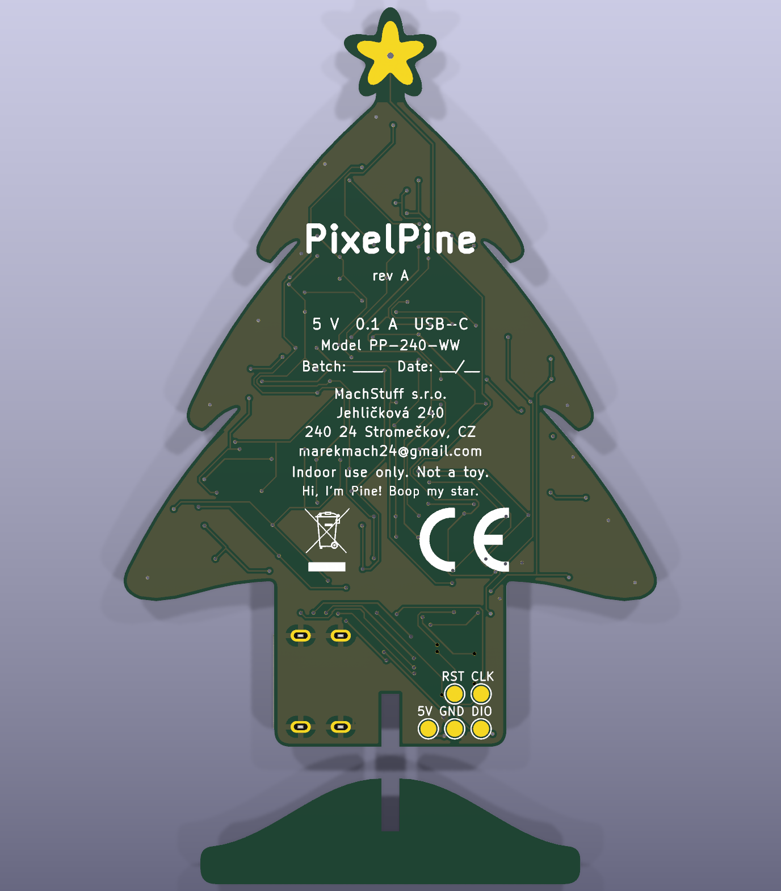

# PixelPine — a 7 cm PCB Christmas tree with 240 charlieplexed LEDs

KTE Project 1 · design-for-manufacture study · rev A · 2026-09-23

A chubby, cute, 70 mm tall PCB tree covered in **240 warm-white 0603 LEDs** on a 2.12 mm grid. The LEDs are
charlieplexed on 16 pins of a **$0.13 Puya PY32F003** (Cortex-M0+, 64 KB flash) with software PWM. It runs from USB-C and slots into a
PCB stand fin. The tree is a character, **Pine**, whose job is showing light shows. He's bad at it: he daydreams,
naps, gets grumpy and gets excited to show you things. You interact with him through the capacitive star, which
senses tap, pet, press, a front-and-back squeeze and tickles. The product firmware runs on the first boards and
matches the simulator frame for frame ([`firmware/pixelpine/`](firmware/pixelpine/README.md)).
Landed cost ≈ **€3.2 at 1 000 pcs, €2.0 at 10 000 pcs**; suggested shelf price **€12.90**.

**Try Pine in your browser: [machmar.github.io/pixelpine](https://machmar.github.io/pixelpine/)** (the animation simulator).

| Front | Back |
|---|---|
|  |  |

## Deliverables

| You asked for | Where |
|---|---|
| Schematic | [`hardware/pixelpine_schematic.pdf`](hardware/pixelpine_schematic.pdf) · KiCad 10 project [`hardware/pixelpine.kicad_pro`](hardware/pixelpine.kicad_pro) (ERC: 0 errors, 0 warnings) |
| PCB shape and layout | [`hardware/pixelpine.kicad_pcb`](hardware/pixelpine.kicad_pcb): outline, stand fin, all 267 parts (+2 logo marks) placed with nets, silkscreen, CE/WEEE marks, **routed on 2 layers** (Freerouting, then finished by hand in KiCad: GND pour on both layers, 142 vias). DRC: 0 unconnected, schematic parity 0 issues; 2 cosmetic *starved thermal* notes (see the order guide). The LEDs sit in a routing-friendly arrangement: see [LED arrangement](#led-arrangement) |
| BOM (LCSC / JLCPCB) | [`docs/bom.md`](docs/bom.md) · JLC upload files [`hardware/production/jlc_bom.csv`](hardware/production/jlc_bom.csv), [`jlc_cpl.csv`](hardware/production/jlc_cpl.csv) |
| **Order files** | [`hardware/production/`](hardware/production/README.md): Gerber + drill zips for the tree (PCB + assembly) and the stand fin (bare PCB), BOM/CPL, 3D previews, and an order guide with every JLC setting and what to check in the placement preview |
| PC app to preview the animations | [`simulator/index.html`](simulator/index.html), live at [machmar.github.io/pixelpine](https://machmar.github.io/pixelpine/) (published from `simulator/` by `.github/workflows/pages.yml`): open it in any browser; works offline apart from fonts. Pine runs live: touch his star (hover / click / hold / shift / ctrl / fast clicks) and watch his feelings change. Preview mode plays any show, face or transition. Includes an electrical model of the charlieplex (current sag, PWM depth, refresh, pin current) |
| Pine: character, faces, transitions, gestures | [`docs/animations.md`](docs/animations.md): behaviour state machine, emotions, 15 light shows, 16 faces, 6 transitions, touch gestures, RAM/flash budget |
| Market analysis | [`docs/market-analysis.md`](docs/market-analysis.md) |
| EU certification setup | [`docs/eu-compliance/`](docs/eu-compliance/README.md): applicability matrix, EMC test plan, technical file + risk assessment, DoC template, labels and leaflet (EN/CZ) |
| Final price analysis incl. assembly | [`docs/cost-analysis.md`](docs/cost-analysis.md), generated by [`docs/cost_model.py`](docs/cost_model.py) |
| Connectivity & power consumption | [`docs/power-and-connectivity.md`](docs/power-and-connectivity.md) |
| Product firmware (beyond the brief) | [`firmware/pixelpine/`](firmware/pixelpine/README.md): the simulator ported to C and running on the board: **59 KB of 63 KB flash, 6.9 KB of 8 KB RAM**, 50 fps, 122 Hz BCM scan. Checked frame by frame against the simulator's own JavaScript: Pine's state machine and emotions identical in every whole-Pine test, LED levels within 1 step of 255 on ≥ 99.99 % of LED-frames there (per show: 93–100 %, fireflies lowest). Touch calibrated on the board; room-light sensing isn't possible on rev A (and how rev B fixes it). Flashing: [`firmware/flash/`](firmware/flash/README.md) |
| Firmware fit check | [`firmware/sizetest/`](firmware/sizetest/README.md): real compile of all shows, faces, brain and drivers for both MCUs. The original CH32V003 overflowed (20.9 KB of 16 KB), so the MCU was switched to the PY32F003F18P6: **17.2 KB of 64 KB flash (27 %), 1.9 KB of 8 KB RAM (23 %)**, built with the Arm GNU Toolchain. See [`docs/animations.md`](docs/animations.md#firmware-budget-measured-by-a-test-compile) |
| Design spec | [`docs/superpowers/specs/2026-09-23-pixelpine-design.md`](docs/superpowers/specs/2026-09-23-pixelpine-design.md) |
| All docs as PDF | [`docs/pdf/PixelPine-documentation.pdf`](docs/pdf/PixelPine-documentation.pdf): everything above in one linked PDF (cover, contents), plus one PDF per doc in [`docs/pdf/`](docs/pdf/). Regenerate with `python docs/export_pdfs.py` after editing a doc |

## Key numbers

| | |
|---|---|
| LEDs | 240 × XL-1608WWC-06 (0603, 2500–3000 K) at 45°, 2.12 mm pitch |
| MCU | Puya PY32F003F18P6 (TSSOP-20, pinout 1, 24 MHz internal oscillator): 16 charlieplex lines (incl. SWD pins and BOOT0) + ADC touch star (PA7) + NRST; SWD programming |
| Character | 6 emotions (energy, focus, mood, annoyance, excitement, bond in flash), 16 faces, 6 transitions |
| Parts | 263 placements, 8 line items, 552 SMD joints, single-sided |
| PCB | 2-layer FR-4 1.6 mm, LF-HASL, JLC standard process (0.10 mm tracks and spaces at the narrowest, 0.3 / 0.4 mm vias); 1658 track segments (1991 mm), 142 vias, GND pour on both layers, 0 unrouted. Tree 50.5 × 70 mm, stand fin 36 × 10 mm |
| Supply | USB-C 5 V, 3–12 mA typical (≈ 7 mA average), 19 mA max → ≤ 0.1 W |
| Light | ≈ 2 lm total, so outside the EU light-source ecodesign/energy-label scope |
| Pin current | ≤ 16.2 mA per GPIO by design (20 mA rated) |
| PWM | 8-bit binary-code modulation, 16 phases, 122 Hz refresh |
| CE route | EMC 2014/30/EU (EN IEC 55015 + EN 61547) + RoHS; GPSR, WEEE, PPWR, REACH obligations |

## LED arrangement

The 240 LED positions are a fixed 2.12 mm grid, but *which* anode/cathode pair sits at which position is a free choice,
and it decides whether the board can be routed at all. The first version interleaved the pairs (`anode = n mod 16`),
which leaves every one of the 480 LED pads as an island of its own, and Freerouting stalled with 76 connections still
open after 87 minutes.

The 45° LEDs form a "brick" lattice with only ~0.55 mm between neighbouring pads. If two neighbouring pads are on the
same line net, a tiny F.Cu bridge joins them for free, so a net can be a few big copper islands instead of 30 loose
pads. [`hardware/scripts/optimize_leds.py`](hardware/scripts/optimize_leds.py) (simulated annealing, C core in
`optimize_leds.c`) arranges the 240 pairs for exactly that: 480 separate pads became 141 islands, only the links between
islands need real wiring, and the board routes on **2 layers** in about 2 minutes (it also stopped needing the 4 layers
that the old arrangement was thought to need). The result is [`hardware/led_assignment.json`](hardware/led_assignment.json),
committed; `geometry.py` reads it, so the schematic, PCB, simulator map and firmware tables all follow from it. Every
LED keeps the same orientation; the optimiser can also turn LEDs round by 180° (`--flip`) for ~15 % fewer islands, but
that wasn't needed.

Side effect: neighbouring LEDs now sometimes share an anode line (17 % of the LED pairs closer than 3.2 mm, against
6 % with the old interleaving), so a lit blob loads some scan phases harder than before. The numbers are in
[`docs/power-and-connectivity.md`](docs/power-and-connectivity.md#which-leds-share-a-phase).

## Regenerating the hardware

> **Since 2026-10-01 the board is finished by hand in KiCad** (GND pour, extra vias). `build_all.py` would
> regenerate it from the scripts and drop those edits, so it now stops unless you pass `--regenerate`. For order
> files run `export_gerbers.py` (KiCad's Python) and `export_fab.py`; see
> [`hardware/production/README.md`](hardware/production/README.md).

Everything in `hardware/` was generated from one geometry module, so it stays consistent:

```bash
python hardware/scripts/build_all.py
```

`geometry.py` (outline, LED grid, charlieplex map from `led_assignment.json`) → `gen_footprints.py` → `gen_sch.py`
(+ ERC, netlist check) → `gen_pcb.py` (KiCad's bundled Python) → `route.py` (Freerouting, ~2-5 min; if connections stay
open it routes again from scratch, up to 4 runs) → DRC and parity → 3D renders → JLC BOM/CPL. It also refreshes
`simulator/led_map.js`, so the simulator always shows the real LED positions. After editing the outline, run
`python hardware/scripts/geometry.py --search` and paste the new pitch into `GRID_PITCH`, then
`python hardware/scripts/optimize_leds.py` (needs a C compiler, 10–20 min) to re-arrange the LEDs for the new grid.
The firmware's per-LED tables come from the same map: `python firmware/pixelpine/gen_tables.py`, then
`python firmware/pixelpine/build.py flash` builds and programs a board, and `python firmware/pixelpine/test/compare.py`
checks the firmware against the simulator.

## Open items before ordering

Order files are ready: [`hardware/production/README.md`](hardware/production/README.md). At order time, check
LCSC stock for the 240 LEDs per board and look at the LED polarity and U1 pin 1 in JLC's placement preview.

1. **Firmware: done on the first board** (2026-11-03): it powers up at 4.97 V with no short, flashes through a
   J-Link ([`firmware/flash/`](firmware/flash/README.md)) and runs Pine ([`firmware/pixelpine/`](firmware/pixelpine/README.md)).
   Still open: touch thresholds measured on one board and one hand (measure a batch); the EMC worst-case and
   production-test firmware builds.
2. **Room light can't be sensed on rev A**: in a full charlieplex every LED has an anti-parallel twin, so no LED can
   work as a photodiode, and Pine stays in "lights on" mode. Rev B fix at no cost: leave one LED unpopulated
   ([`firmware/pixelpine/README.md`](firmware/pixelpine/README.md#room-light)).
3. **Hover isn't detectable** with the star electrode (a finger 1 cm away is below the noise); tap, pet, press,
   squeeze and tickle work.

Done: PCB routed on 2 layers (LED arrangement optimised for it, DRC clean), manufacturer name, address (Jehličková 240, 240 24 Stromečkov: made up for the school project, replace it with the
registered address for a real product) and e-mail on the product, U1 and J1 placement orientation checked, MCU choice final
(PY32F003F18P6, kept over the cheaper F002A for firmware-update headroom).
